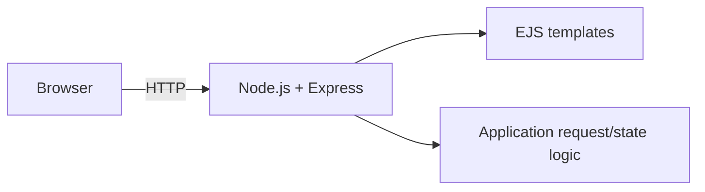
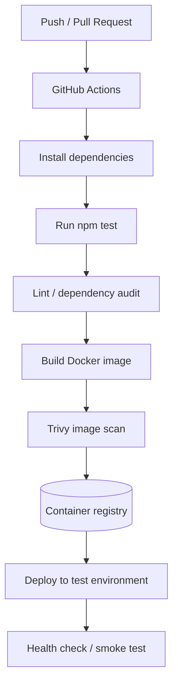

<div align="center">


  

</div>

---

# Node.js Todo App — CI/CD Practice

A small Express/EJS to-do list application that can serve as the application layer for learning Docker, automated testing, code quality checks and deployment workflows.

   

[**Repository source**](https://github.com/AhmedRaza92110/node-todo-cicd-junkin-project) · [Application source](node-todo-cicd/) · [App README](node-todo-cicd/README.md)

## 🏗️ Application architecture



The app uses Express routes and EJS templates to render a to-do interface. The repository contains a Dockerfile and Mocha/Chai-related test dependencies. It does **not currently include a GitHub Actions workflow or a configured deployment pipeline**.

## 🔁 Suggested CI/CD architecture



This diagram is the proposed pipeline to add next; it is not yet implemented in the repository. The test command should be verified locally first and made reliable before adding it as a required CI gate.

## 💡 Why use this project for CI/CD practice?

- **Small codebase:** lets you focus on pipeline design instead of complex business logic.
- **Server-rendered templates:** introduces the relationship between application code and HTTP runtime.
- **Docker:** gives the pipeline a portable artifact to build and deploy.
- **Automated tests:** the package includes Mocha/Chai and related testing dependencies to build on.
- **Incremental learning:** start with tests, then add image builds, security checks, registry publishing and deployment.

## ▶️ Run locally

Prerequisites: a supported Node.js version and npm.

```bash
cd node-todo-cicd
npm install
npm start
```

Open the URL printed by the application (commonly `http://localhost:3000`, depending on the app's port configuration).

## 🐳 Run with Docker

```bash
cd node-todo-cicd
docker build -t node-todo:local .
docker run --rm -p 3000:3000 node-todo:local
```

Check the Dockerfile's exposed port and the application's configured port before running if they differ.

## 🛣️ Recommended next steps

- [ ] Verify and document the local test command; add/repair tests for the main routes.
- [ ] Add a GitHub Actions workflow for pull requests and pushes to `main`.
- [ ] Add linting and dependency vulnerability checks.
- [ ] Build images with commit-SHA tags and scan with Trivy.
- [ ] Publish to a container registry using repository secrets.
- [ ] Deploy to a test host and add a health-check/smoke-test step.
- [ ] Document rollback and secret management.

> **Portfolio status:** this repository is currently an application/containerization starter. The pipeline diagram is a proposed roadmap; do not present automated CI/CD as implemented until the workflow file and successful run evidence are committed.

<div align="center"><sub>Small application, real-world delivery concepts.</sub></div>
